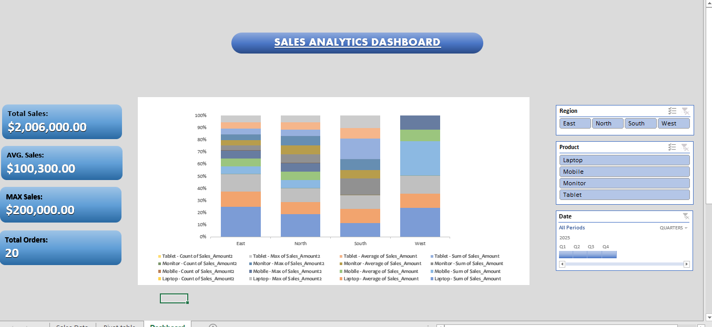

# Sales Dashboard

## Project Overview

This project is an interactive **Sales Dashboard created in Microsoft Excel** to analyze sales performance and present key business insights in a clear and easy-to-understand format.

## Objective

The main objective of this dashboard is to track and analyze:

* Total Sales
* Average Sales
* Total Orders
* Maximum Sale
* Sales by Region
* Sales by Product
* Sales by Employee

## Tools & Excel Features Used

* Microsoft Excel 2019
* Pivot Tables
* Pivot Charts
* Slicers
* Excel Formulas
* Conditional Formatting
* Data Analysis
* Dashboard Design

## Dashboard Features

The dashboard includes interactive slicers that allow users to filter the data and analyze specific products or categories.

Key KPI metrics include:

* **Total Sales:** $1,910,000
* **Average Sales:** $95,500
* **Total Orders:** 20
* **Maximum Sale:** $180,000

## Analysis

The dashboard provides a quick overview of sales performance and helps identify differences in:

* Product-wise sales
* Region-wise sales
* Employee-wise performance
* Overall sales performance

## Dashboard Preview

## Project Files

* `Sales_Dashboard.xlsx` — Complete Excel dashboard
* `Dashboard.png` — Dashboard screenshot

## Key Learning

Through this project, I practiced creating an interactive Excel dashboard using Pivot Tables, Pivot Charts, Slicers, and Excel data-analysis techniques.

[Sales_Dashboard_Portfolio.xlsx](https://github.com/user-attachments/files/31345627/Sales_Dashboard_Portfolio.xlsx)
